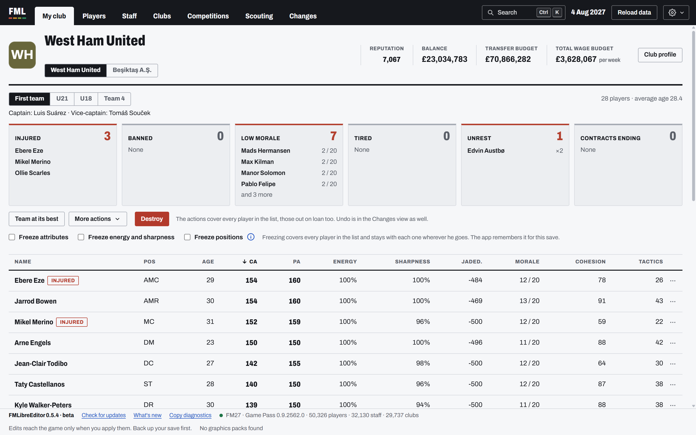
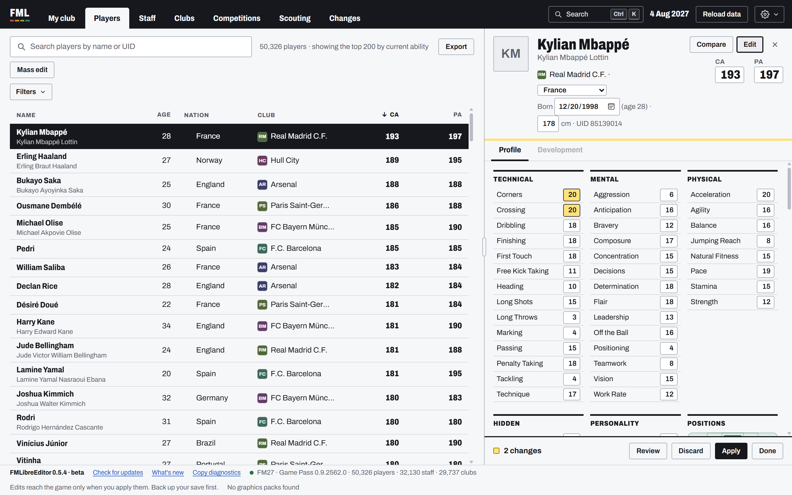

  

<h1 align="center">FMLibreEditor</h1>

  A free, open-source live editor for <b>Football Manager 27</b>. 
  Edit players, staff and clubs while the game runs.

  
  
  

Works on **Windows** (Xbox / Game Pass and Steam) and **macOS** (Steam).

**Open source, and open to your help:** fixes, translations, testing on your copy of the game or
findings about FM27's data are all welcome. See [Contributing](#contributing).

## Download

- **Windows 10 or 11:**
  [FMLibreEditor-Setup.exe](https://github.com/tozmoz/FMLibreEditor/releases/latest/download/FMLibreEditor-Setup.exe)
  or the [portable zip](https://github.com/tozmoz/FMLibreEditor/releases/latest/download/FMLibreEditor-portable.zip)
- **macOS:**
  [FMLibreEditor-macOS.zip](https://github.com/tozmoz/FMLibreEditor/releases/latest/download/FMLibreEditor-macOS.zip)

How to install and use it: [docs/INSTALL.md](docs/INSTALL.md). How the Windows builds are
signed: [Code signing policy](#code-signing-policy).

> **Status: beta.** Use it with offline, single-player saves, and back up your save
> before editing.

## What it does

- **Browse and find:** every player, member of staff, club and national team, with search and
  filters. **Ctrl+K** (**⌘K** on macOS) searches all of them and the app's commands.
- **Edit:** attributes, abilities, positions, personality, traits, names, contracts with their
  bonuses and clauses, reputation, finances and stadiums.
- **Fix in one click:** heal injuries, lift bans, remove unhappiness, raise morale and
  fitness, for one player or a whole team.
- **Freeze:** a player's attributes, energy and match sharpness, or a club's money, so they do
  not go down while the app runs.
- **Move people:** transfer, swap or release players, sign free agents, move staff between
  clubs. A transfer or a loan can also be left for the game to make, so it shows in the
  player's career history.
- **Change the rules:** a league's prize money, and a competition's squad rules, such as how
  many foreign players a squad may register.
- **Follow your club:** the app opens on the club you manage and who needs a look there, and
  a profile's Development tab draws how a player has changed over time.
- **Mass edit, undo and export:** change many at once with a preview, undo any change, and
  write the lists to CSV or JSON.
- **Care with your save:** it checks how it reads the game before it writes, stays read-only
  on a version of FM27 it has not been checked with yet, and changes nothing after the game
  loads another save until you reload the data.

In English, Turkish, Spanish, German, French, Indonesian, Italian, Japanese, Korean, Brazilian
Portuguese, Russian and Simplified Chinese. The app updates itself on Windows and macOS.

Everything it does: [docs/FEATURES.md](docs/FEATURES.md). The game shows a change once you
press **Continue** in FM.

## Where it works

| System | FM27 from | |
| --- | --- | --- |
| Windows 10 or 11 | Xbox / Game Pass | Checked before every release |
| Windows 10 or 11 | Steam | Checked before every release |
| macOS, Apple silicon | Steam | Supported |
| macOS, Intel | Steam | Players, staff and clubs |

After an update of FM27 the app opens read-only until a release knows the new version, which
usually takes a few days. Which versions of the game it knows, and the features that wait on
some of them: [docs/COMPATIBILITY.md](docs/COMPATIBILITY.md).

## Contributing

FMLibreEditor is built in the open, and you do not need to know reverse engineering to help.
A first pull request can be small: a typo, a clearer sentence, one translated screen.

- **Pick up an issue:** the ones labelled
  [help wanted](https://github.com/tozmoz/FMLibreEditor/issues?q=is%3Aissue+is%3Aopen+label%3A%22help+wanted%22)
  are open for anyone. Comment on one to take it, so nobody else starts the same work. Have an
  idea of your own? Open an issue or ask in
  [Discussions](https://github.com/tozmoz/FMLibreEditor/discussions).
- **Work on the interface without the game:** `npm run dev` in `app/` opens it in a browser with
  made-up players (React + TypeScript).
- **Translate:** another language is one file, see
  [CONTRIBUTING.md](CONTRIBUTING.md#translating).
- **Test:** try a release on your storefront (Game Pass, Steam, macOS) and
  [report](https://github.com/tozmoz/FMLibreEditor/issues/new/choose) what does not work.
- **Research:** found where FM27 keeps something? Share it in an issue; the notes in
  [docs/recon](docs/recon) show what is known already.

[CONTRIBUTING.md](CONTRIBUTING.md) explains how to start, and
[docs/DEVELOPING.md](docs/DEVELOPING.md) how the editor works, how to build it and the
command-line probe. Questions are welcome in
[Discussions](https://github.com/tozmoz/FMLibreEditor/discussions). Please follow the
[code of conduct](CODE_OF_CONDUCT.md).

Thanks to everyone who has contributed code, findings and testing; see the
[contributors](https://github.com/tozmoz/FMLibreEditor/graphs/contributors) and the issues where
much of FM27's data was worked out.

FMLibreEditor is not affiliated with or endorsed by Sports Interactive or SEGA. Memory-layout
leads come from GPL-3.0 project:
[fm-editor](https://github.com/barak14/fm-editor) by barak14

## Code signing policy

Free code signing provided by [SignPath.io](https://about.signpath.io), certificate by
[SignPath Foundation](https://signpath.org).

Windows signing is being set up: the Windows builds of the releases so far are not signed yet.
Once it is in place, the installer and the programs in it are signed only when they are built
by this repository's [release workflow](.github/workflows/release.yml) on GitHub Actions, from
the source code in this repository. The macOS app is signed and notarized with the
maintainer's Apple Developer ID.

Team roles:

- Committers and reviewers: [tozmoz](https://github.com/tozmoz), the maintainer. Every pull
  request from anyone else is reviewed by the maintainer before it is merged.
- Approvers: [tozmoz](https://github.com/tozmoz). Each release will be approved by hand before
  it is signed.

Privacy: this program will not transfer any information to other networked systems unless
specifically requested by the user or the person installing or operating it. The one
exception it makes on its own: when it starts (at most once every six hours), and when
**Check for updates** is pressed, it asks GitHub's public API for the latest FMLibreEditor
release, sending nothing about you, your computer or your game. An update is downloaded from
GitHub only when you click **Update**. The app reads and changes the memory of the Football
Manager 27 process it connects to and nothing else on your system; on disk it writes only its
own settings, its change history and its records of how your careers' players develop, and the
exports you ask for.

## License

GPL-3.0-or-later. See [LICENSE](LICENSE). The app's typeface,
[Archivo](https://github.com/Omnibus-Type/Archivo) by Omnibus-Type, is bundled under the SIL
Open Font License 1.1 ([app/licenses/Archivo-OFL.txt](app/licenses/Archivo-OFL.txt)).
